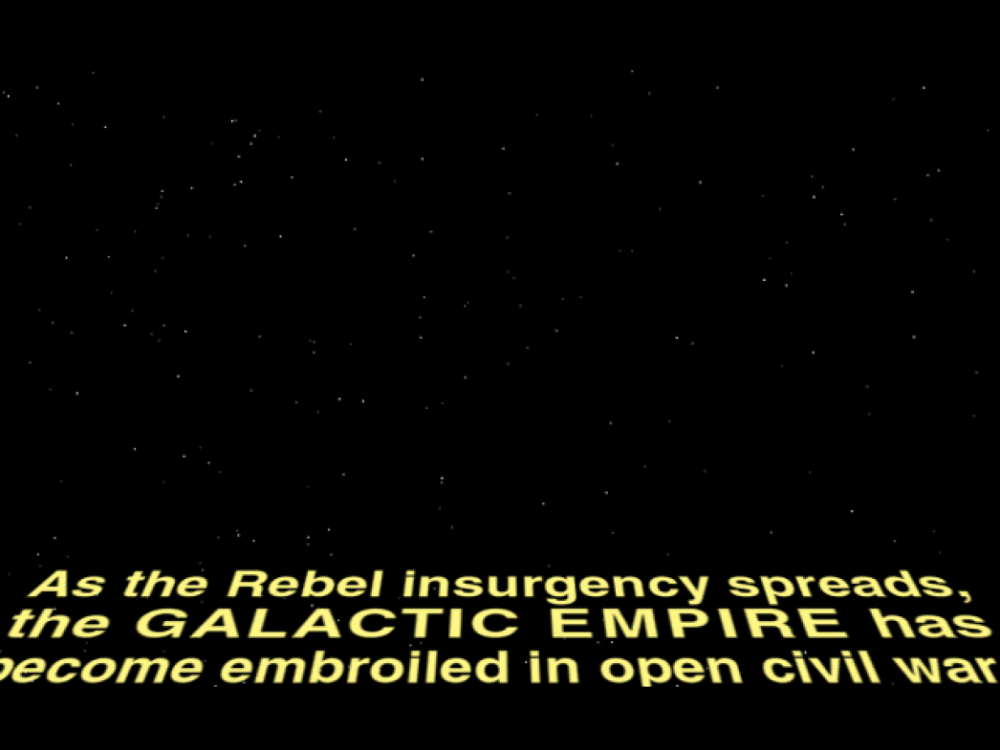
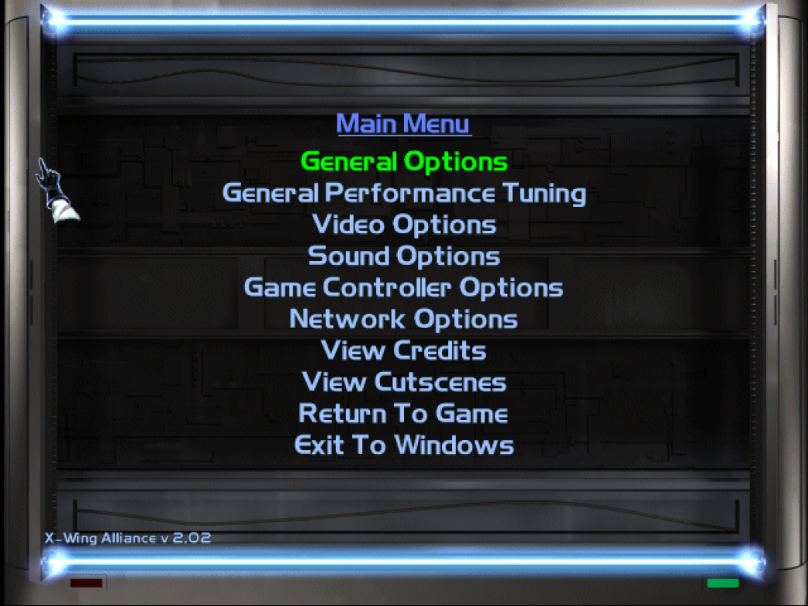
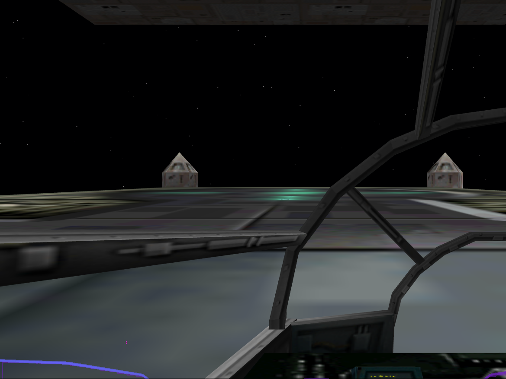
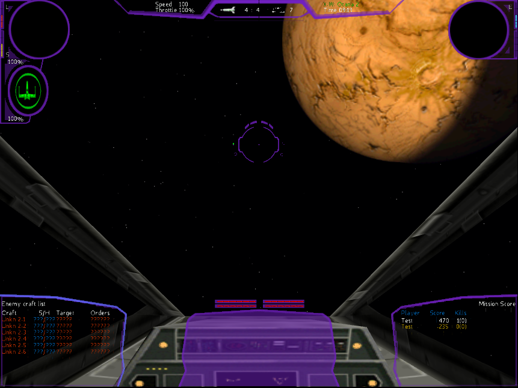
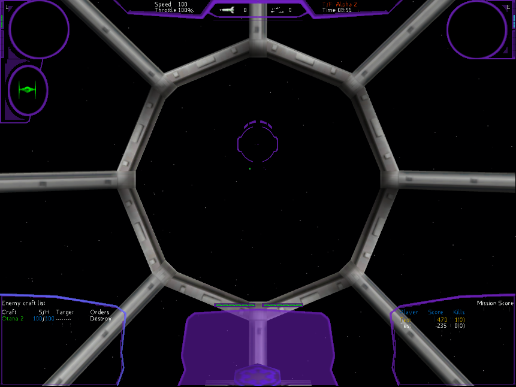

# X-Wing Alliance recomp

A static recompilation of **Star Wars: X-Wing Alliance** (the Steam edition,
v2.02) to a native 32-bit Windows program, on the host and remaster of the
[X-Wing vs TIE Fighter recomp](https://github.com/sp00nznet/xvt-recomp)
(itself from the X-Wing and TIE Fighter recomps). The game's x86 code is
lifted to C by [pcrecomp](https://github.com/sp00nznet/pcrecomp) and runs on
its native32 runtime.

You supply your own copy of the game. Nothing from it is in this repo.

## Status

Lifted clean (7811 functions, 0 errors). Boots, plays the intro movies, and
goes through the concourse, mission overview and briefing into flight. Campaign
mission 1 flies in 3D at 800x600, 32-bit, with the full cockpit and HUD, sound
effects and voice. Music plays when it is on in the game's sound options.

Campaign mission 1 plays to victory under a test script (tools/mission1.keys)
with the host's autopilot.

Multiplayer runs on the host's own DirectPlay (TCP 47700; XWA makes DirectPlay
through COM, which the host answers): two machines host and join a TCP/IP
skirmish and fly it together (netlab scenarios/xwa/lan.sh).

Not yet: the remaster options.







## Step by step

1. Copy the Steam folder `Star Wars X-Wing Alliance` into `game/`.
2. Unwrap the SteamStub DRM with [Steamless](https://github.com/atom0s/Steamless):
   ```
   Steamless.CLI.exe game\xwingalliance.exe
   move game\xwingalliance.exe.unpacked.exe work\xwa.exe
   ```
3. Catalogue and lift it:
   ```
   py -3 ..\pcrecomp\tools\disasm\disasm32.py work\xwa.exe -o work\functions.json
   py -3 run_lift.py --all
   ```
4. Build: `build.cmd` (Visual Studio 2022, x86 tools).
5. Run: `build\xwarecomp.exe --run`

## License

MIT for the code here (LICENSE); the game is © Lucasfilm / LucasArts / Totally Games.
