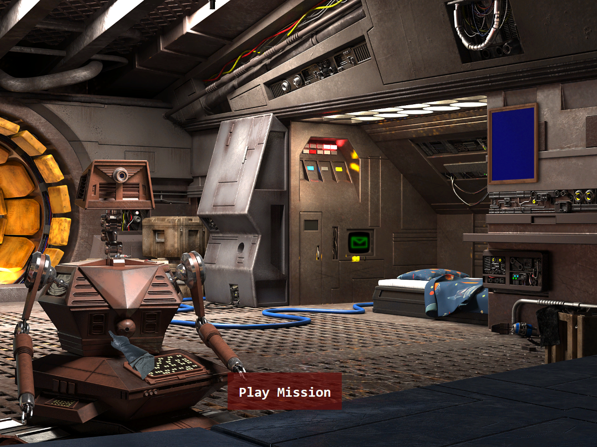
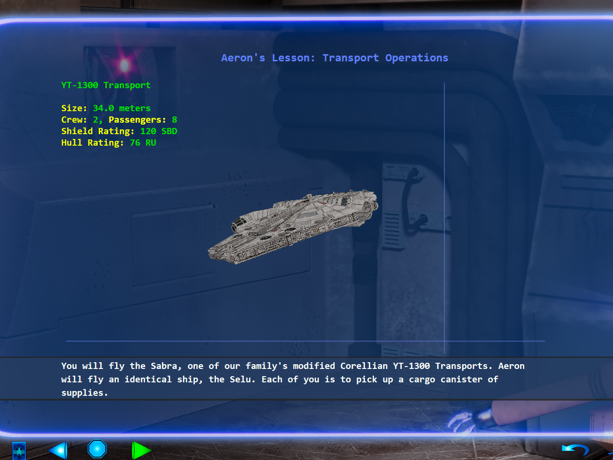
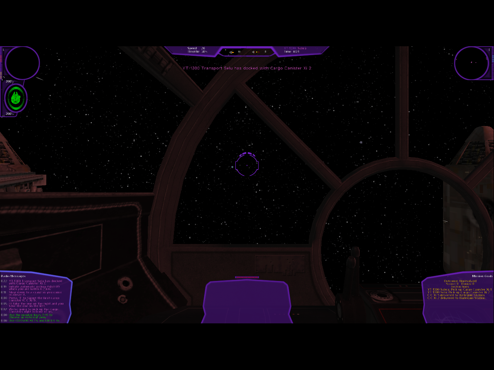
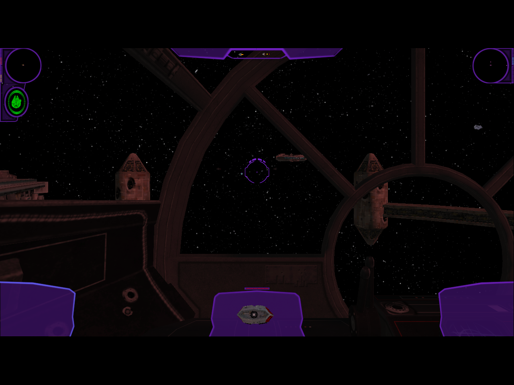

# X-Wing Alliance Upgrade (XWAU) on the recomp

The [X-Wing Alliance Upgrade](https://www.xwaupgrade.com/) is the community's
big remaster of XWA: new high-detail ship models, HD concourse and briefing
art, MP4 movies, a Direct3D 11 renderer, and about 50 "hooks" that change how
the game works. The hooks and the renderer are by Jérémy Ansel
([xwa_hooks](https://github.com/JeremyAnsel/xwa_hooks),
[xwa_ddraw_d3d11](https://github.com/JeremyAnsel/xwa_ddraw_d3d11)); the
upgrade is by the XWAU team. None of it is in this repo. You download it from
them and the recomp runs their files as they ship.

The XWAU build is a second exe, `xwaurecomp.exe`, next to the plain
`xwarecomp.exe`. The plain build is unchanged.






## Status

| | |
|---|---|
| Title, HD front end, pilot creation | works |
| Family room, mission select, briefing (XWAU models) | works |
| Launching flight from the briefing (the button at 554,461) | works |
| Flight with XWAU models, cockpit, HUD and renderer | works: mission 1 launches and flies |
| Briefing craft name | sometimes printed one letter per line |
| Tech room door animation | may play wrong (see "Code the hooks rewrite") |

## Why it isn't a drop-in

XWAU's hooks don't replace files the game loads. They patch the game's code:

1. XWAU ships its own `dinput.dll`. When the game calls `DirectInputCreateA`,
   that DLL loads every `hook_*.dll` and writes each one's byte patches into
   the running exe (each exports `GetHookPatch(i)`: offset, old bytes, new
   bytes).
2. Most patches turn a game instruction into a `call` to one of two
   trampolines (0x5A8B20, 0x5A8B30). The trampoline saves the registers
   (pushfd/pushad) and calls `DirectInputCreateA(0, 0, 0, esp)`, and the hook
   DLL finds the hook to run by the return address.
3. A hook can read and change the saved registers, return a value, or change
   the return address so the game continues somewhere else (142 hooks do).
4. Some hooks also write into the game's code while it runs: constants,
   opcodes, and `call`/`jmp` targets pointing into their own DLL.

A recompiled game never runs the original machine code, so none of this
happens by itself: the patches have to be in the code before it's lifted, and
the lifted code has to call the hooks the way the trampolines would.

## How the recomp does it

**1. Bake the patches into the exe** (`tools/hookbake.c`). `hookbake` loads
each `hook_*.dll` from the XWAU game folder and writes its patches into a
copy of `XWINGALLIANCE.EXE`, giving `work/xwau.exe`. It maps the exe at
0x400000 first because some hooks read game memory while they load. Two
lists come out alongside it:

- `work/xwau.exe.ptrsites`: dwords in the patches that hold addresses inside
  the hook DLLs. Those differ from run to run, so the lifter reads them live
  from memory instead of baking them in.
- Code bytes the hooks rewrote during a test run (`hook_codewrites.log`,
  written by the XWAU build while it runs) are baked in too, except the
  dwords in `tools/hook_codewrites.txt` (34 constants and targets the hooks
  set at run time, which are always read live).

**2. Lift it** (`run_lift.py --exe work/xwau.exe --out src/recomp/gen_xwau`).
The same lift as the plain build, plus:

- The patch sites above become live reads (`MEM32(addr)`), including
  `call`/`jmp` instructions whose target a hook rewrites.
- Every call to a trampoline becomes `XWA_HOOK_CALL(isint, return address)`.
- The 150 addresses hooks may send the game to (`tools/hook_jumps.txt`)
  become block starts, and each hook call is followed by a switch that jumps
  to whichever one the hook chose. A target its caller has no label for
  (the hook's patch cut the branch that led there; `FrontResGetArea`, which
  every button's hit test uses, is one) is also lifted as a function of its
  own, and the hook call tail-calls it.

This needs lifter and runtime changes, on the pcrecomp branch
[`xwau/code-sites`](https://github.com/sp00nznet/pcrecomp/tree/xwau/code-sites).

**3. Run the hooks for real** (`src/runtime/host.c`, built with `XWA_HOOKS=1`).
At startup the host loads every `hook_*.dll` itself and applies their patches
in memory, as XWAU's `dinput.dll` would, so the live reads see the right
values. A hook call builds the same pushfd/pushad frame the trampoline does,
calls the hook, and writes back the registers it changed. Because the lifted
code keeps the CPU flags in variables, the host saves and restores those
around each hook too. Without that, the game skipped its front-end setup and
every label said "No text".

**Hooks calling the game.** The hooks call game functions by address, and in
a recompiled game every such call faults into the lifted code. That cost one
exception per vertex in flight (about half a frame a second). At startup the
host rewrites each hook DLL's direct calls into game functions (`call rel32`,
and `mov reg, imm32` + `call reg`) to go through a small thunk instead
(`native32_direct_calls`): flight runs about 17 times faster. The hooks are
also told the game window is in front when a test script drives it, since
`hook_windowed` drops the mouse otherwise.

DirectDraw comes from the game folder's `ddraw.dll`, which is XWAU's D3D11
renderer. The hooks talk to it directly. DirectInput and DirectSound come
from Windows.

**Code the hooks rewrite.** While the XWAU build runs, a thread compares the
game's code with how it looked at startup every 2 seconds and logs changes to
`hook_codewrites.log` in the game folder. Rerun `hookbake` with that log and
re-lift to bake them in. One hook flips an opcode back and forth (the tech
room door), and a baked exe can only hold one of the two states.

## Using it

You need the plain build working first (README, "Step by step"), and an XWA
install to put XWAU on. Use a **separate copy** of the game for this: XWAU
overwrites a lot of files.

1. **Get XWAU.** From [xwaupgrade.com](https://www.xwaupgrade.com/), the full
   2025 release (`XWAU2025_Full_1.0.0.zip`, about 6 GB) and the latest update
   (`XWAU2025_UPD_1.1.0.zip`).
2. **Install it** onto the copy of the game, with the XWAU installer or by
   hand: each group zip holds an `OverwriteOn\` folder to copy over the game
   folder, in group order, then the update the same way. The install comes
   with an already-patched `XWINGALLIANCE.EXE`.
3. **Keep it windowed** (recommended): in the game folder's `Hooks.ini`, under
   `[hook_windowed]`, set `X = 64`, `Y = 64`, `Width = 1280`, `Height = 960`.
4. **Bake the hooks** into the exe (`hookbake.cmd` finds Visual Studio itself):
   ```
   tools\hookbake.cmd
   copy work\hookbake.exe <xwau game>\
   cd <xwau game>
   hookbake.exe <xwau game> <xwau game>\XWINGALLIANCE.EXE <repo>\work\xwau.exe <repo>\tools\hook_codewrites.txt
   ```
   Run it from the game folder: some hooks are .NET and look for their
   assemblies next to the running exe. Expect `210 patches applied, 0 skipped`.
5. **Lift it**, against the pcrecomp branch:
   ```
   git -C ..\pcrecomp worktree add ..\pcrecomp-xwau xwau/code-sites
   set PCRECOMP=..\pcrecomp-xwau
   py -3 run_lift.py --all --exe work\xwau.exe --out src\recomp\gen_xwau --roots 0x5A8B20,0x5A8B30
   ```
6. **Build** in its own folder (the first build takes a while):
   ```
   set BUILD_DIR=build-xwau
   set CMAKE_ARGS=-DPCRECOMP=<repo>\..\pcrecomp-xwau
   build.cmd --target xwau
   ```
7. **Run** from the XWAU game folder:
   ```
   copy build-xwau\xwaurecomp.exe <xwau game>\
   cd <xwau game>
   xwaurecomp.exe --run --exe <repo>\work\xwau.exe --game <xwau game>
   ```

If you change XWAU's hooks (`Hooks.ini` options that add or remove patches,
a new hook DLL, an XWAU update), redo steps 4 to 6.

## Debug switches

| Variable | Does |
|---|---|
| `XWA_HOOKLOG=1` | prints the first call at each hook site: how far a run gets |
| `XWA_SEEN=1` | writes `seen.txt`, a sample of the functions that ran |
| `XWA_WNDLOG=1` | logs the game window and focus changes |
| `XWA_PROF=1` | every 20 s, where the game thread spends its time (modules, lifted functions) |

Screenshots in the XWAU build (`--keys` `shot=`) come from a hook on the
renderer's `Present`, so they work in flight and show the whole frame.

## Files

| File | What |
|---|---|
| `tools/hookbake.c`, `tools/hookbake.cmd` | bakes the hook patches into an exe |
| `tools/hook_jumps.txt` | the 150 addresses hooks send the game to |
| `tools/hook_codewrites.txt` | the 34 code dwords hooks set at run time |
| `run_lift.py` (`--exe`) | the hook-aware lift |
| `src/runtime/host.c` (`XWA_HOOKS`) | loads and calls the hooks |
